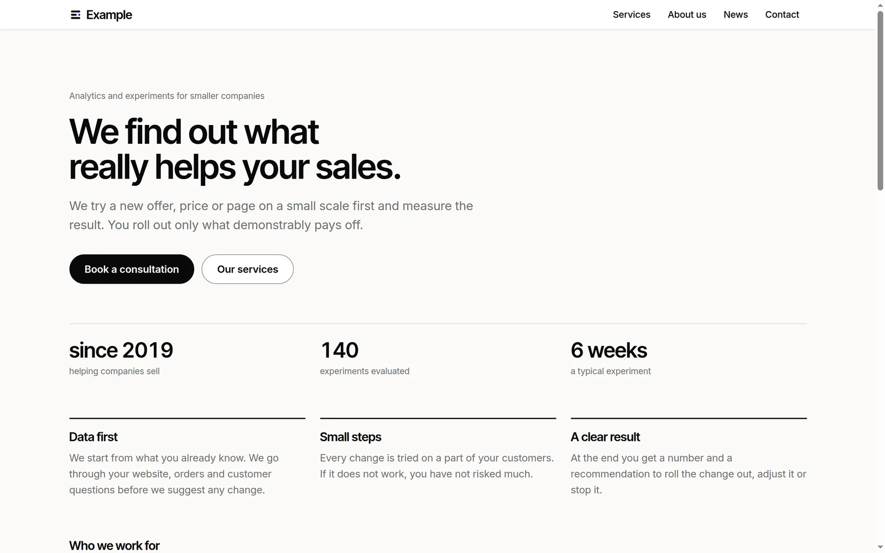

# Website

The company website of **Example**, an invented Organization, in Czech and
English. All content is fictional.

A module of Lazurio for the Organization's website: its pages, services,
news and contacts. People and agents change the website by changing its
content in `data/v2/`, Markdown and YAML, without touching the code; the App
builds it into static pages that load fast, read well on a phone and give
search engines what they need. The look is the Organization's design system.
The repository follows the
[Lazurio Module Standard](https://github.com/Lazurio/LazurioPlatform/blob/main/docs/module-standard.md).



## A template in the Marketplace of Lazurio

This repository is also a public template: another Organization can take the
website's structure, App, skills for agents and tests and make them its own.
The Marketplace of Lazurio offers it under "Přidat do Organizace"; an agent
then follows [`docs/adoption.md`](docs/adoption.md), creates a private module
of that Organization and merges a release of this repository into it, so that
later releases arrive as ordinary merges. Nothing is installed or published
without the person's instruction. LazurioTemplates publishes the template.

- App generation `app/v2`: the App has no data layer of its own; its content
  lies beside it in `data/v2/` with a declared structure the App checks.
- Stack profile [`content@2026.11`](https://github.com/Lazurio/LazurioPlatform/blob/main/docs/stack-profiles.md#content): Bun 1.4.4, Astro 7.4.5,
  TypeScript 6.0.3, Biome 2.6.4, every version exact.
- Two languages: the interface, the example content and the starting content
  in Czech (the default) and English; `data/v2/language.yaml` chooses one for
  the whole website.
- The look is the design system
  [`LazurioTemplates/design-system`](https://github.com/LazurioTemplates/design-system)
  v1.0.0, merged into `design-system/` as its `docs/adoption.md` asks, and used
  directly: its tokens, stylesheet and components. A newer release, or the
  Organization's own design system, arrives as a merge
  ([`docs/extending.md`](docs/extending.md#the-design-system)).
- [`docs/publishing.md`](docs/publishing.md): what the build produces and how
  the website gets onto the internet. Lazurio shows it to the Organization;
  publishing it to the public is a separate step on a hosting of the
  Organization's choice.
- Releases are annotated tags `v<semver>` with a GitHub Release
  ([`CHANGELOG.md`](CHANGELOG.md)).
- Screens for the Marketplace card, the same shots in each language:
  [`docs/screenshots/cs/`](docs/screenshots/cs/) and
  [`docs/screenshots/en/`](docs/screenshots/en/).

## What the website has

- **Pages** from `data/v2/<language>/pages/`, each at the address of its file
  name, in the main menu or the footer as their front matter says. The home
  page has a headline with buttons, numbers, highlights, the services and the
  newest news.
- **Services** (or products) with a card and a page of their own, with a price.
- **News**, newest first, with drafts that stay off the website.
- **Contacts** on their page, in every footer and in the data for search
  engines: address, e-mail, phone, hours, people and company details.
- **For search engines and link previews**: a title and description on every
  page, canonical addresses, Open Graph and Twitter cards, `sitemap.xml`,
  `robots.txt` and the Organization in schema.org data. Indexing stays off
  until the website is public.
- **Accessibility**: one h1 per page, landmarks and a skip link, a menu that
  works with a keyboard and without JavaScript, images with alternative text,
  and colour pairs that reach WCAG AA in the light and dark theme.
- **Speed**: static pages, no web fonts, a few hundred bytes of JavaScript for
  the menu, and images converted to WebP in the sizes screens need.

## For agents

The module's process is its [`AGENTS.md`](AGENTS.md) and its skills, in
`.agents/skills/` (Codex) and `.claude/skills/` (Claude Code):

| Skill | When |
| --- | --- |
| `edit-page` | "přidej stránku", "oprav tuhle větu", "add a page", "fix this sentence" |
| `write-news` | "napiš aktualitu", "write a news item" |
| `change-contacts` | "změň kontakty", "we have a new phone number" |

Each skill changes `data/v2/<language>/`, checks it with `bun run check`,
looks at the result in the browser and prepares a pull request.

## Layout

| Path | Holds |
| --- | --- |
| `data/v2/` | The content: the language, and per language the settings, contacts, pages, services, news and images ([field reference](data/v2/README.md)) |
| `app/v2/` | The App (Astro, TypeScript) that builds the website |
| `app/v2/src/content/` | The schemas of the content, the rules of the whole website and the language |
| `app/v2/src/lib/texts.ts` | The words of the interface the code writes itself, in both languages |
| `app/v2/src/styles/site.css` | The website's layout on the design system's tokens |
| `design-system/` | The merged release of the design system; never edited here |
| `design-system.lock.json` | The repository, tag, commit and tree of that release |
| `.agents/skills/`, `.claude/skills/` | The skills for agents |
| `docs/` | Adoption, extending, publishing and the Marketplace screens |
| `lazurio.module.json` | Module id, port lease and Apps |
| `LICENSE`, `NOTICE` | MIT license; what it covers and the third-party notes |

## Run and develop

Start it through Lazurio (`lazurio module start <Organization>/website`) or
from the Launchpad. Opened from `main`, Lazurio builds the website (`bun run
build`) and serves `dist/`; the App reads its host and port only from the
listener Lazurio assigns and refuses to start without it.

```sh
cd app/v2
bun install --frozen-lockfile
bun run prepare:app     # astro sync
bun run validate:data   # the content of data/v2 only
bun run check           # astro check, Biome, the content and every test, the build of each kept language included
bun run build           # the static website in dist/, in the language of data/v2/language.yaml
```

## License

MIT, see [`LICENSE`](LICENSE). The company, people, prices and results are
fictional; [`NOTICE`](NOTICE) says what the license covers and lists the
third-party material.
